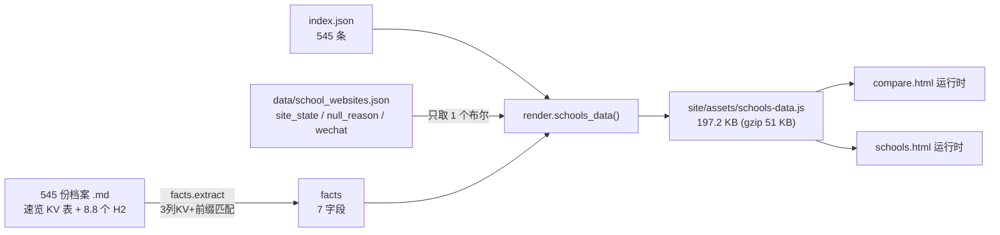
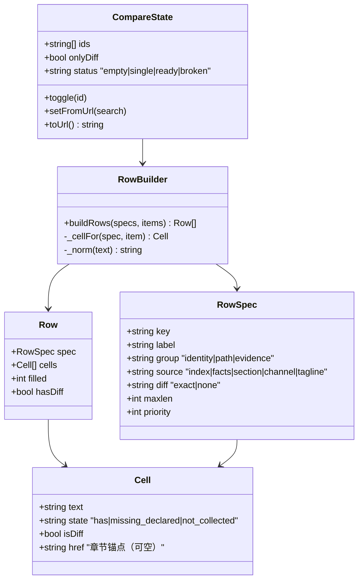

# 「对比」功能：架构评审与优化方案

> 撰写日期：2026-10-26　|　评审人：高见远（架构师）
> 评审对象：`templates/compare.html`、`templates/compare.js`、`assets/pages.css:202-249`（对比页样式块，含 720px 断点）、`src/pipeline/facts.py`、`src/pipeline/render.py:92-118,162-167`
> 数据规模：545 所学校 / 11 个区 / 3 个学段（实测，已复核）
> 说明：本文只做评审与设计，**未修改任何业务代码**。所有数字后面的「已复核/估算/推导」标注了获取方式。

---

## 0. 一句话结论

**现在的「对比」不是对比表，是「四张并排的卡片」——它没有解决「看出差异」这件事，只解决了「放在一起」。**

三个结构性判断：

1. **呈现层缺一个「行」的概念**。四列各自渲染 `dl`，行与行之间没有任何对齐机制；实测「对口初中」42% 的值超过一行宽度、「校址」38%、「投档线」37%，`tagline` 平均 61.7 字（已复核）——**只要有一列某个值多一行，它后面所有行就整体错位**。这不是美化问题，是「横向读不出对应关系」的可用性坍塌。
2. **数据层被 197.2 / 200 KB 的资产预算事实上冻结了**（已复核：`site/assets/schools-data.js` 197.2 KB，`check.py:24` 预算 200 KB）。再加任何字段必破预算——所以现在的事实是「不是不想加字段，是架构上已经加不进去了」。
3. **能力在站内是孤岛**。首页/学校库/详情页没有任何入口（`detail.html` 全文无 `compare`），且候选输入框是全站**第 4 份搜索实现**（`compare.js:64-83`），连 `aliases`（俗称表）都不查——学校库能搜到「拉力琅」，对比页搜不到。

**但这个功能的底子是好的**：2–4 校上限、`localStorage` 记忆、`?ids=` 深链、构建期 0 错 0 警，方向对、工程纪律在。缺的不是重写，是**补三层**：行的模型、差异的语义、入口的通路。

---

## 1. 现状：它到底做了什么

```
templates/compare.html (18 行)
  ├─ #pick            输入框（type=search，无 form、无 combobox 角色）
  ├─ #pickList        <ul role="listbox">（候选，运行时 innerHTML 重建）
  ├─ #picked          已选 chips（裸 div + aria-label）
  ├─ #cmp             对比容器（运行时 innerHTML 重建）
  └─ .cmp-actions     [复制分享链接] [清空]
      <script src=assets/schools-data.js>
      <script></script>   ← 内联，不可缓存

compare.js (187 行)
  DATA  = __SCHOOLS__.rows 按 cols 展开 → 补 id(=level+'-'+name) 与 url
  ├─ loadSelected()  ?ids= 优先 > localStorage['nj-compare']，filter+slice(MAX=4)
  ├─ suggest(q)      name+short+district+tier 子串，前 8 条
  ├─ rowsFor(items)  5 行固定元数据 + 「至少一所有值」的 facts 行 + tagline  ← 行定义硬编码在 UI 函数里
  └─ render()        每校一个 .cmp-col（h2 + badges + dl + 链接）
      .cmp{display:grid;grid-template-columns:repeat(var(--n),minmax(0,1fr))}
      @media(max-width:720px){.cmp{grid-template-columns:1fr}}   ← 堆成单列
```

数据来源链路（构建期）：



**关键结构缺陷**：`render.schools_data()`（`render.py:92-118`）把「列表页要的」和「对比页要的」塞进同一个 JSON，逼着两个页面加载同一份全量数据；而 `webmap` 里明明有 545 条完整的渠道核查结果（`site_state` / `null_reason` / `wechat`），却只导出了 `hasSite` 这一个**布尔**（`render.py:109`）。

---

## 2. 现状与不足

### 2.1 完整性（能不能比出东西）

| # | 问题 | 位置 | 为什么是问题 | 影响 |
|---|---|---|---|---|
| C1 | **可对比字段极少且极稀疏** | `facts.py:16-24` / `compare.js:92-110` | 实测量（已复核）：7 字段覆盖 6%–35%，**196/545（36%）完全无 facts**，平均 1.36 项/校。4 列并排时 fact 区大面积是「—」 | 实际只能比出「性质/区/梯队/一句话定位」，而前三项在 545 条里几乎是常量，真正有区分度的信息全缺 |
| C2 | **`对口初中` 抽取口径丢了 107 所小学** | `facts.py:19,48`（`key.startswith(n)`） | 档案里同一语义有 4 种键名：`对口初中`(255) / `主要生源/对口初中`(21) / `施教区对口初中`(12) / `对口初中（口径）`(9)。startswith 只认第一种 | 实测（已复核）：**107 份小学档案有真实对口值却被丢弃**，194 → 约 300（35%→55%，含少量重叠）。这是**零成本可回收的最大一块数据** |
| C3 | **档案里 56%–100% 覆盖的章节完全不进对比** | `render.py:105-110` | 实测（已复核）：升学 421、师资 427、施教区 420、口碑 312、特色 309、荣誉 182 份档案都有独立 H2，但对比页对此一无所知 | 家长最想比的「升学/师资/特色」在对比页是空白；对比页只能比索引字段 |
| C4 | **官方渠道退化为二值，丢掉了已核查的全部细节** | `compare.js:98` `hasSite?'有官网':'暂无可用官网'` | 详情页 `partials.html:17-42` 已有 4 档文案 + 公众号状态；`school_websites.json` 里有 `null_reason`（未检索到 292 / 源站下线 26 / 待核查 25 / 内容停更 5 / 平台槽位空置 5 / 被抢注 2 / 从未建站 1 / 域名彻底退役 1）与 `wechat`（id 72 / 仅存在 12）——**已复核**，全部被一个布尔抹平 | 对比页上一所「官网 502」的学校和一所「从未建站」的学校显示成同一句「暂无可用官网」；而这层信息详情页是有能力说清的 |
| C5 | **候选搜索不查俗称表** | `compare.js:69` vs `render.py:110` | 数据里已经有 `aliases` 列（`拉力琅`/`秦外`），`schools.js:71-77` 用整词匹配，对比页完全不看 | 同一站内两套召回：「拉力琅」在学校库 3 条，对比页 0 条；阿拉伯数字 `29中` 也不归一 |
| C6 | **零入口** | `detail.html` 全文 / `schools.html` 卡片 | 全站 545 个详情页都是死胡同；对比能力藏在二级导航第 3 项 | 覆盖率≈0。呼应审查报告 P1-2「详情页无加入对比」 |
| C7 | **无「差异」语义** | `compare.js:112-146` | 只做并排渲染，不做任何行级比较：无相同/不同标记、无分组、无「只看差异」 | 4 列同构文本靠肉眼找不同，10 行以上就放弃 |
| C8 | **无打印/导出** | `pages.css:202-249` | `tokens.css:116-123` 已有 `@media print` 令牌（白底黑字），但对比页没有打印规则，打印出来是四张带阴影的卡片 + 输入框 | 家长的真实动作是「打印下来和家里商量」，这条链路断了 |

### 2.2 健壮性（会不会出错）

| # | 问题 | 位置 | 为什么是问题 | 影响 |
|---|---|---|---|---|
| R1 | **行对齐依赖内容等长** | `.cmp` grid + 每列独立 `<dl>`（`compare.js:136-141`） | 4 列各有一个 `<dl>`，行高由各列自己的内容决定，没有任何 row 级对齐（无 subgrid、无固定行高、无 `<table>`）。实测（已复核）：`feeder` 42% 的值 >21 字、`address` 38%、`score` 37%；4 列布局每列约 21 汉字/行 | **某列某个值多一行 → 该列后续所有行整体下移**。行越往下错位越大，「第 3 行是投档线」这种对位关系彻底消失。这是「对比表」最致命的缺陷（由 CSS 结构推导，非截图验证） |
| R2 | **`?ids=` 不去重** | `compare.js:29-36`（只有 `filter` + `slice`） | `?ids=A,B,A` 会渲染 3 列，其中 A 出现两次 | 分享链接被手工拼接/拼接脚本出错时，出现「同一所学校跟自己对比」的荒诞结果，且没有报错 |
| R3 | **深链失效时静默降级** | `compare.js:35` | 无效 id 被 `filter(BY_ID)` 静默丢弃；全部无效时只显示「先选两所学校」 | 用户拿到一条失效链接，看到的是「你还没选」，而不是「这条链接无效」。属于「把错误伪装成空态」 |
| R4 | **前端自造 id，与 `index.json` 的 id 不是同一套** | `compare.js:7` vs `index.json` | 实测（已复核）：index 的 id 是 `小学-鼓楼区-南京市琅琊路小学`，前端拼的是 `小学-南京市琅琊路小学`，**545/545 全部不一致**。`?ids=` 里存的是前端拼法 | 今天靠「前后端拼法一致」侥幸成立。任何时候有人为了对齐 index 改成带区，**所有历史分享链接静默失效**（读 0 条 → 空态 R3），且没有版本号可分辨 |
| R5 | **选择不写回 URL** | `compare.js` 全文无 `history.*State` | 后退无法回退选择；刷新后 URL 与本地状态不一致；`loadSelected` 只在初始化读 URL | 呼应 P1-8（学校库同款问题）。用户「加一所、再退回去」做不到 |
| R6 | **上限提示覆盖候选列表** | `compare.js:46-50` | 第 5 所时 `list.innerHTML='最多对比 4 所…'`，把正在输入的候选整体替换；无 `aria-live`；输入框清空后这条提示还留着（`suggest` 只在 `input` 事件重绘） | 用户正在挑学校时被一条提示抢走列表；读屏用户完全收不到这条反馈 |
| R7 | **`role="listbox"` 声明了但不合规** | `compare.html:11` + `compare.js:77` | 输入框无 `role=combobox`/`aria-expanded`/`aria-controls`/`aria-autocomplete`；`li` 无 `id`、无 `aria-selected`；无 `aria-activedescendant`；无 ↑↓、无 Esc、无 Tab 关闭、点击外部不关闭 | 读屏用户「以为能用键盘，按了没反应」——**比不声明角色更糟**（P2-4 原文）。这是全站无障碍骨架里唯一的破口 |
| R8 | **`#picked` 是裸 div 带 `aria-label`** | `compare.html:14` | 无 role 的 div 上 `aria-label` 被多数 AT 忽略 | 「已选学校」这个分组语义丢失，chips 读起来是散落的按钮 |
| R9 | **焦点可视化被覆盖** | `site.css:84-87`；`pages.css:213` | `.picker input{outline:none}` + `:focus` 只给 box-shadow（0,2,1 特异性 > `:focus-visible` 的 0,1,0）；`.pick-list li:focus{outline:none}` | 键盘用户在输入框和候选上失去标准焦点环（P1-5 同类问题在新代码里重犯） |
| R10 | **`--n` 走 inline style** | `compare.js:126` | `check.py:30` 的 `RE_STYLE` 只拦 `<style>` 标签（`<style[\s>]`），不拦 style 属性；CSP 禁止 inline style 时列数失效 | 换 4 条 `[data-n="k"]` 属性选择器即可，零成本 |
| R11 | **无 `<noscript>`** | `compare.html` | 关 JS 后页面只剩标题与三个空 div；`?ids=` 深链也无效 | 呼应 P1-7。至少应给一段 `<noscript>` 说明 + 学校库入口 |
| R12 | **`file://` 下复制出的链接是 `null/compare.html`** | `compare.js:173` | 站点设计上支持双击打开（`render.py:98` 明确写着「`<script src>` 不受 file:// 限制」），但 `location.origin` 在 file:// 下是字符串 `"null"` | 本地预览/离线分发的用户分享出一条坏链接 |

### 2.3 可扩展性（改不改得动）

| # | 问题 | 位置 | 后果 |
|---|---|---|---|
| E1 | **行定义硬编码在 UI 函数里** | `compare.js:92-110` `rowsFor()` | 一行 = 一个内联对象 `{label, get}`；行的顺序、取值范围（`some(有值)` 才显示）、格式化、是否参与差异比较，全部混在一个函数里。加一行 = 改 JS + 重建 + 无测试可依。想加「差异高亮」「分组」「打印」都没有插入点 |
| E2 | **数据资产已贴预算上限，扩展被冻死** | `render.py:92-118` + `check.py:24` | 实测（已复核）：197.2 KB / 预算 200 KB，其中 `tagline` 91.8 KB、`facts` 43.7 KB。**任何新增字段都会触发 `check.py` 警告**。也就是说「加字段」现在需要先做架构改造，不能靠 `cols.push()` |
| E3 | **同一份文案三处维护** | `partials.html:17-42`（Jinja 渠道文案）/ `compare.js:98`（JS 渠道文案）/ `facts.py:27-35`（标签） | 渠道语义改一次要改两处（还有一个被丢弃）；字段加一个要改 `FACT_KEYS`+`FACT_LABELS`+前端渲染+预算表 |
| E4 | **内联脚本不可缓存，且构建期零校验** | `compare.html:24`；`check.py:114,146` | `check.py` 的「重复代码块」与语法检查**只覆盖 `assets/app.js`**，不覆盖任何 `templates/*.js`。`compare.js` 写坏一个括号，页面照样构建成功、0 错 0 警，线上表现为「对比页永远空态」 |
| E5 | **零测试** | 无 `tests/` | `facts.extract` 无单测——扩同义词表等于闭眼改行为；`rowsFor`/`loadSelected` 无测试——R2/R3/R4 这三个 bug 都能靠 3 条断言拦住 |
| E6 | **第 4 份搜索实现** | `compare.js:64-83` vs `schools.js`（全套） vs `app.js:53` `heroSearch` vs `404.html` `nfGo` | 别名、数字归一、命中评分、兜底四级能力在对比页全部缺失，而且**不会随重构同步**（搜索报告 5.1 计划抽 `search.js` 时，对比页是第 4 个需要改的调用点） |
| E7 | **守卫自己缺守卫** | `check.py:36-40,98-160,227-259` | `NO_CANONICAL` 定义两次、重复定义检测整段出现两次、内链校验整段出现两次、changelog 重复标题校验出现两次——**一个专门用来抓「重复写入」的检查模块，自己被重复写入了**。说明「防重复」目前靠人眼 |

---

## 3. 实测后决定「不改」的项

评审的价值一半在说清「不值得做什么」。以下都实际测算过：

| 曾考虑 | 实测结论 | 决定 |
|---|---|---|
| **线性扫描 545 条要建索引/前缀树** | 对比页候选过滤 545 条，与学校库同量级；搜索报告已实测单次 0.2–0.7 ms | **不做**。545 条任何索引都是纯负债 |
| **引入 React/Vue 做对比表** | 全站零框架，`.cmp` 全部逻辑 187 行 | **不做**。一个 187 行的页面不值得引入运行时 |
| **按需分片加载数据（按区/首字母切成 11 个文件）** | 对比页可跨区选校，切片后最坏情况要加载 4 个分片 + 4 次请求 | **不做**。只做「列表页/对比页」两级拆分（见 5.1），不做进一步分片 |
| **禁止跨学段对比（小学 vs 高中）** | 站内有 10 组「小学部/初中部」同名档案（`render.py:197-201`），跨学段对比正是刚需场景 | **不做限制**。学段徽章已在每列头部，语义清楚 |
| **把 `tagline` 从数据资产里拿掉以腾预算** | 91.8 KB，但学校库 545 张卡片和对比表最后一行都靠它 | **不拿掉**。改为拆文件而不是删字段 |
| **对比结果导出为图片/PDF** | 静态站要引 canvas/打印库；`tokens.css` 的 print 令牌已能覆盖 90% 需求 | **不做**。只做 `@media print` 样式，交给浏览器打印 |
| **「多组对比方案」收藏（A 组：琅小 vs 拉小；B 组：…)）** | 真实使用是「同时对 2–4 所」，多组收藏会让 `localStorage` 协议、UI、深链全部复杂化 | **不做**。留 P2 观察再说 |
| **差异高亮做到「词级 diff」** | 4 列 × 12 行，词级 diff 的噪声远大于收益（「南京市鼓楼区琅琊路 7 号」vs「…拉萨路 7 号」全亮） | **不做**。只做「整格相同/不同」（见 5.3） |

---

## 4. 可改进方向

```
方向 A  数据扩张     同义词表外置 + 补 5 个高覆盖字段 + 章节索引      → 决定「有没有东西可比」
方向 B  呈现重构     真表格 + 行分组 + 差异高亮 + 三态空值            → 决定「比不比得出来」
方向 C  接入通路     详情页/学校库入口 + URL 同步 + 键盘              → 决定「有没有人用」
方向 D  工程护栏     拆模块 + 测试 + check 守卫 + 与搜索合并          → 决定「改不改得动」
```

| 方向 | 收益 | 成本 | 风险 | 取舍 |
|---|---|---|---|---|
| **A 数据扩张** | 无 facts 学校 196 → 0；平均 1.36 → **3.72** 项（模拟实测，见 5.1） | 中（同义词表 + 拆数据资产） | **会撞 200 KB 预算**，不拆文件做不成；可能「字段多了但都是未获取」 | 必须与 D 的拆文件一起做，且以「有值率」而非「字段数」验收 |
| **B 呈现重构** | 从「并排四卡片」变成真对比表；差异可一眼看出 | 中（表格 + 移动端卡片化回归） | 移动端表格易横向溢出（已有 `data-label` 先例可复用） | **优先级最高**。没有 B，A 加的字段只是让「—」更多 |
| **C 接入通路** | 把已有能力接进主流程；覆盖率从 ≈0 到有 | 低（3 处模板 + 30 行 JS） | 与 P1-2 重叠，需要和详情页改造同批做 | **最便宜、见效最快**，应当第一个做 |
| **D 工程护栏** | 后面三期不再裸奔；顺带修 R2/R3/R4 | 低-中 | 拆模块会短暂动到 `check.py` 预算表 | 与 A 强绑定（拆文件是 A 的前置） |

**推荐顺序：C → B → D+A**（其中 D 的「拆数据资产」必须先于 A 完成）

理由：
- 现在的核心问题不是「数据不够」而是「进来的人也看不出差异，而且根本没人进来」。
- 在 B 落地前扩张数据，只会让用户看到更多「—」和更严重的行错位（R1）。
- A 必须等 D 把单文件拆成「列表页资产 + 对比页资产」，否则**每次加字段都要先跟 200 KB 预算打架**。

---

## 5. 具体优化方案

### 5.0 设计主张：「对比」的本质是看出差异

三条原则，后面所有设计都由它们推导：

1. **行是主角，列是配角。** 对比的读法是「横扫一行，看四格有什么不同」，所以**必须按行对齐**（→ 真表格 + `th[scope=row]`），且每行必须携带自己的元信息（分组、是否有值、是否参与差异）。
2. **「相同」是信息，「不同」也是信息，「没有」更是信息。** 现在三者都渲染成文本，读者无法区分「两校梯队真的相同」和「两校都没填」。→ 三态空值 + 行级有值计数 + 差异标记。
3. **只标「不同」，不标「更好」。** 站点的免责声明是「不构成任何择校建议」。差异高亮只用中性强调色（`--accent-weak`/`--amber-bg`），**禁止绿/红**（语义色留给信度徽章），禁止排序、打分、推荐。

由此得出行的分组（3 组，共 12 行封顶）：

| 组 | 行 | 来源 | 为什么放这组 |
|---|---|---|---|
| **身份** | 学段 / 性质 / 行政区 / 梯队 / **集团归属** | index + facts | 决定「这是一所什么学校」，多为常量，用于确认没比错对象 |
| **通路** | **对口初中**（或 **主要生源小学**）/ 施教区 / 招生计划 / **咨询电话** | facts | 决定「我进不进得去」，是家长真正的决策变量 |
| **证据** | 升学表现 / 师资 / 办学特色 / 荣誉 / 口碑（**章节存在性 + 锚点**）+ 官方渠道 + 一句话定位 | 章节索引 + webmap + index | 决定「这所学校有没有被说清楚」，并诚实暴露数据缺口 |

### 5.1 数据层：怎么扩大可对比字段（不臆造）

#### ① 同义词表外置 + 匹配口径修正（零成本，最大回收）

把 `facts.py` 的 `FACT_KEYS/FACT_LABELS` 搬进 `data/facts_schema.json`，一行一字段：

```json
[
  {"key":"feeder","label":"对口初中","group":"path","synonyms":["对口初中","主要生源/对口初中","施教区对口初中"],
   "diff":"exact","maxlen":60},
  {"key":"group","label":"集团归属","group":"identity","synonyms":["集团归属","所属集团","教育集团"],
   "diff":"exact","maxlen":40},
  {"key":"phone","label":"咨询电话","group":"path","synonyms":["咨询电话","招生电话","联系电话"],
   "diff":"none","maxlen":40},
  {"key":"zone","label":"施教区","group":"path","synonyms":["2026 施教区","施教区口径"],
   "diff":"none","maxlen":48,"truncate":"…（原文见档案）"},
  {"key":"scale","label":"办学规模","group":"identity","synonyms":["办学规模","在校学生","班级数"],
   "diff":"exact","maxlen":40}
]
```

匹配规则从 `startswith` 改为 **「同义词全等」优先，其次「同义词包含」**，并给 `synonyms` 加构建期冲突校验（一个键名只能命中一个字段，否则报错——防止 `施教区` 抢走 `施教区对口初中`）。

**实测投影（我用 545 份档案模拟跑了一遍，标注为「估算」）**：

| 字段 | 现状（已复核） | 扩充后（估算） | 说明 |
|---|---|---|---|
| 对口初中 | 194（35%） | **300（55%）** | 主因是 C2 的 107 份小学被 startswith 丢掉 |
| 施教区 | — | 354（64%） | 只显示「已公开 + 前 48 字」，全文留在详情页 |
| 咨询电话 | — | 265（48%） | 比 `hasSite`(188, 34%) 覆盖更高，且比「有官网」更实用 |
| 集团归属 | — | 160（29%） | **南京择校第一决策变量**（拉力琅芳→二十九中系…），此前完全没进对比 |
| 办学规模/占地 | — | 165（30%） | |
| 招生计划 | 82（15%） | 184（33%） | 同义词补 `2026 电脑派位` |
| 校区/校址 | 162（29%） | 195（35%） | |
| 主要生源小学 | — | 63（11%） | **初中侧的对口通路**，与「对口初中」是不同字段，不可混用 |
| 学费/投档线/班型/创办时间 | 60/37/41/164 | 85/42/46/166 | 增量小，维持现状 |
| **无任何 facts 的学校** | **196（36%）** | **0** | |
| **平均 facts / 校** | **1.36** | **3.72** | |

> 诚实边界：`主要生源小学`（初中）与 `对口初中`（小学）**语义相反**，绝不能合并成一个「对口」字段——那是最容易被误读的一类臆造。

#### ② 章节存在性索引（把 56%–100% 覆盖的章节接进来）

**不能按编号抽取**（三张 B 表的现实约束：同样是「招生」，有的在`三、`有的在`四、`有的在`五、`）。按**关键词**匹配 H2：

```python
SECTION_KEYS = {           # 关键词 → 规范键（命中即记下该标题的 slug）
  "升学": "outcome", "师资": "faculty", "特色": "feature",
  "荣誉": "honor",  "口碑": "reputation", "施教区": "zone",
}
```

实测文件覆盖（已复核，按关键词命中 H2）：速览 545 / 招生 542 / **师资 427 / 升学 421 / 施教区 420 / 口碑 312 / 特色 309 / 荣誉 182**。

产出（每校一条紧凑串，只存命中的 slug）：

```
初中-鼓楼区-南京市第二十九中学初中部  →  outcome=六升学表现;faculty=五师资力量;feature=四办学特色
```

前端只做一件事：**「有独立章节 → 显示 ✓ + 点击跳到详情页该章节」**。

> **这是本方案里最需要克制的一处。** 章节存在 ≠ 有结论，所以：
> - 只表达「该档案是否覆盖这个主题」，**不折算分数/等级/星级**；
> - UI 文案必须写「有独立章节」，不能写「升学数据 ✓」（前者是事实，后者是推断）；
> - 不抽取章节正文做摘要——正文是叙述性长文本（`tagline` 均 61.7 字就是这个量级），抽三句必然失真，而失真即臆造。

#### ③ 渠道状态枚举化（丢掉的那个布尔拿回来）

把 `webmap` 的核查结果压成两个小整数，随数据下发：

| 字段 | 取值 | 实测分布（已复核） |
|---|---|---|
| `channel` | 0=官网可达 / 1=有域名但不可达 / 2=停更 / 3=无 | 188 / 31 / 5 / 321 |
| `wechat` | 0=可关注 / 1=仅存在 / 2=未核查 | 72 / 12 / 461 |

文案字典**只在 `config.py` 定义一次**（`CHANNEL_LABEL` / `WECHAT_LABEL`），同时喂 `partials.html` 与 JSON payload，彻底解决 E3 的双份文案。对比表对应单元格显示为：

```
官网不可达（源站下线）　公众号：可关注
未检索到独立官网　　　　公众号：未核查
```

—— 这比「暂无可用官网」信息量高一个量级，而且**这些字符串已经躺在 `school_websites.json` 里了**，不需要新增核查工作。

#### ④ 缺数据的三种呈现（守住「不得臆造」）

| 状态 | 判定 | 渲染 | 说明 |
|---|---|---|---|
| `has` | 有值 | 正常文本 | |
| `missing_declared` | 无值，且该校档案的「数据缺口」段落/正文声明了该项 | `未获取`（灰字，`title="该校档案已标注未获取"`） | 实测（已复核）：**545/545 份档案正文都含「未获取」字样**，100% 可归因；字段→缺口关键词走白名单映射，映射不到就降级为下一种 |
| `not_collected` | 其余 | `—`（最浅灰，`title="本站未收录此字段"`） | 中立，不暗示「学校没有」 |

行标题右侧显示有值计数：`对口初中 · 3/4 所有值`。**让「这行比不出来」变成显式信息，而不是满屏横线。**

#### ⑤ 数据资产拆分（E2 的唯一出路）

实测（已复核）：

| 组成 | 体积 |
|---|---|
| 现有全量 | **197.2 KB / gzip 51 KB**（预算 200 KB） |
| 去掉 `facts` | 155 KB / gzip 40 KB ← 学校库所需 |
| `facts` 扩到 5 项后 | 278 KB ← **单文件必破预算** |
| 新增列（章节锚 + 渠道枚举） | ~30 KB / gzip ~5 KB |

方案：

```
assets/schools-data.js     列表页所需：name/short/district/level/type/tier/tagline/aliases
                           ≈155 KB / gzip 40 KB          ← schools.html 只加载这个
assets/schools-compare.js  对比页所需：id + facts + sections + channel/wechat
                           ≈150 KB / gzip ~15 KB         ← compare.html 额外加载
```

对比页总下载从 gzip 51 KB 涨到约 **55 KB**（+8%），且只发生在「用户主动进入对比页」时；`check.py` 的预算表按两个条目分别设定（`schools-data.js ≤ 160KB`、`schools-compare.js ≤ 320KB`），并**额外打印 gzip 实测值**——因为 raw 预算对中文 JSON 已经失真（197 KB → 51 KB）。

---

### 5.2 结构层：行模型怎么设计才可扩展

现在 `rowsFor()` 把「行的定义」和「行的渲染」糊在一起。拆成三层，中间那层是**纯函数、无 DOM、可单测**：



运行期契约（`window.__NJ_COMPARE__.buildRows(specs, items)` 返回 `Row[]`），渲染层只做字符串拼装：

```
[{key:'feeder', label:'对口初中', group:'path', filled:3, hasDiff:true,
  cells:[{text:'二十九中初中部',state:'has',isDiff:true,href:null},
         {text:'二十九中初中部',state:'has',isDiff:false,href:null},
         {text:'未获取',state:'missing_declared',isDiff:true,href:null},
         {text:'—',state:'not_collected',isDiff:true,href:null}]}]
```

**加一行 = 往 `specs` 里加一条**（数据侧 `data/compare_rows.json`），前端零改动。行顺序由 `group` + `priority` 决定，`source` 决定取值从 payload 的哪一列来。

渲染层改成**真表格**（解决 R1 的行对齐）：

```html
<div class="cmp-wrap">
<table class="cmp-table" data-n="3">
  <caption class="sr-only">3 所学校对比</caption>
  <thead><tr><th scope="col">对比项</th>
    <th scope="col">南京市琅琊路小学</th>…</tr></thead>
  <tbody data-group="identity">
    <tr><th scope="row">性质</th><td data-label="性质">公办</td>…</tr>
  </tbody>
  <tbody data-group="path">…</tbody>
</table>
</div>
```

- 语义：`th[scope=row]` 让读屏能报出「第 3 行、第 2 列」；表格天然按行对齐。
- 移动端（≤720px）：复用站内已有模式（`responsive.css:66-84` 的 `data-label` 卡片化）——`td::before{content:attr(data-label)}`，每校变一张卡。**因为窄屏不保留表格，所以不引入横向溢出**（这是站内硬约束 4）。
- 打印：`@media print` 只保留 `table`，隐藏 `.picker/.chips/.cmp-actions`。
- `--n` 改 `data-n`，CSS 用 4 条 `[data-n="2|3|4"]` 规则（解决 R10）。

---

### 5.3 交互层

| 项 | 方案 |
|---|---|
| **差异高亮** | 逐行对 `cells` 做 `_norm()`（trim + 全角转半角 + 阿拉伯/中文数字归一）后比较：`filled ≥ 2 && new Set(values).size > 1` → 该行 `hasDiff`；值与行内众数不同的格子标 `.is-diff`。视觉：左侧 3px `--accent` 竖条 + `--amber-bg` 底（**不用红绿**，语义色留给信度）。`diff:"none"` 的行（校址/施教区/电话/一句话定位）不参与标记——否则 4 列全亮，等于没标 |
| **只看差异** | `aria-pressed` 开关（复用 `.chip` 组件），打开后隐藏 `hasDiff=false` 的行；顶部显示「已隐藏 7 行相同项」并提供还原。空结果时提示「这 3 所在已收录字段上完全一致」——这本身是有价值的信息 |
| **键盘可达** | `#pick` 加 `role=combobox aria-expanded aria-controls=pickList aria-autocomplete=list aria-activedescendant`；`li` 带 `id` + `aria-selected`；↑↓ 移动、Enter 选中、Esc 关闭、Tab/点击外部关闭、关闭后 `aria-expanded=false`；焦点环恢复（`.picker input:focus-visible{outline:2px solid var(--accent);outline-offset:2px}` 并去掉 `outline:none`）。**候选列表改由 `aria-live="polite"` 的独立状态行播报「找到 8 所」，上限提示同走该区域**（解决 R6 的覆盖问题） |
| **URL 同步** | 选择变化 → `history.replaceState(null,'','?ids='+ids.join(','))`（只 replace 不 push，避免污染历史栈）；`popstate` 回读并重渲染；`?ids=` 首次进入即视为「当前状态」，用户改动后照常写回 URL（解决 R5） |
| **上限/下限** | 0 所：空态 + 「同区其他 3 所」快捷加入；1 所：`—— 再加 1 所开始对比`，并把候选列表默认展开（按同区/同学段排序）；≥2 所：正常；≥4 所：第 5 次点击时把「上限」写进 `aria-live` 状态行 + 候选列表保留（解决 R6），并给出「替换哪一所」的建议（点已选 chip 移除） |
| **深链健壮性** | `?ids=` 解析：去重（解决 R2）、`decodeURIComponent` 容错、按 `id` 精确匹配、兼容旧拼法（`level-name` 反查一次）；若全部无效 → 显示「**这条分享链接已失效**（可能是学校改名/链接过期）」，并给学校库入口（解决 R3） |
| **入口** | ① `detail.html` 头部加「⇄ 加入对比」（写 `localStorage` → 跳 `compare.html?ids=…`）；② `schools.js` 卡片加「⇄ 加入对比」按钮（`aria-pressed` 反映是否已选）；③ 对比页空态给「同区热门 3 所」；④ `compare.html` 加 `<noscript>` 说明 + 学校库入口（解决 C6/R11） |
| **复制链接** | `location.origin` 为 `"null"`（file://）时降级为「请从已部署的站点复制链接」而不是产出坏链（解决 R12） |
| **打印** | `@media print`：隐藏交互区，表格 `border:1px solid var(--line)`、去底色/阴影、`th` 加粗；页脚自动带 `nj-compare` 的 URL（`@page` 不便控制，改为在表尾输出一行 `data-print-url`） |

---

### 5.4 工程层

#### ① 模块拆分（顺带解决 P2-2 与 E6）

```
assets/compare-core.js   ~180 行，纯函数，无 document
                         normalize / buildRows / diffRows / parseIds / toUrl
assets/compare.js        ~150 行，只碰 DOM（渲染、事件、URL、剪贴板）
```

- `compare.html` 改 `<script src="assets/compare-core.js">` + `<script src="assets/compare.js">`（可缓存、可单测、可 `node --check`）。
- **与搜索模块的关系**：候选输入框不再自己实现匹配，改调搜索侧能力。
  - 若「搜索重构」先落地 → 直接 `search.query(q, {limit:8})`；
  - 若对比先做 → 把 `schools.js` 里的 `normTerm/aliasHit/score/hasTerm/hayMain`（`schools.js:42-121`）提到 `assets/search-core.js`，两页共用。**这是「第 4 份实现」的收敛点，不要再写第 5 份。**

#### ② `check.py` 新增守卫（每条都对应今天已存在的隐患）

| 守卫 | 拦什么 | 对应问题 |
|---|---|---|
| **G1** `cols.length === rows[i].length`，且 `name/id` 列非空 | 前端拿到 `undefined` 拼进字符串，表现为「某校永远搜不到/对比不了」 | E2 / 搜索报告 R7（迄今未加） |
| **G2** `facts` 的每个 key 必须存在于 `factLabels` | 新增字段忘加标签 → 界面显示 `undefined` | E3 |
| **G3** payload 必须含 `id` 列且唯一；`id` 与 `schools/*.html` 文件名可互推 | R4 的「两套 id 协议」再次漂移 | R4 |
| **G4** 数据里 `sections` 的每个 slug 必须在对应详情页 HTML 中以 `id="slug"` 出现 | **死锚点**——`check.py:245` 的内链校验会剔除 `<script>`，运行期拼出来的链接完全不在校验范围内 | 新增风险 |
| **G5** 资产预算分档：`schools-data.js ≤160KB`、`schools-compare.js ≤320KB`，并打印 gzip 实测值 | 数据膨胀无感 | E2 |
| **G6** `node --check assets/*.js`（`schools.js`/`compare.js`/`compare-core.js`/`app.js`） | 内联脚本语法错误静默上线（现在 `check.py` 只看 `app.js` 的重复块） | E4 |
| **G7**（顺手）给 `check.py` 自己加一条「同一函数体出现两次」的告警 | 守卫自己被重复写入 4 次 | E7 |

环境已具备：`node v22.22.2`（已核实）。

#### ③ 测试

```
tests/
  compare-core.test.mjs    # node --test，import assets/compare-core.js
  compare-cases.json       # 用例表，非开发者可维护
  test_facts.py            # 对 20 份抽样档案断言 extract 结果（先锁现状，再改行为）
```

`compare-cases.json` 就是「把今天的行为钉死」的那张表：

```json
[
  {"name":"ids 去重",   "ids":["A","B","A"], "expect":["A","B"]},
  {"name":"未知 id",    "ids":["X","A"],     "expect":["A"], "status":"broken"},
  {"name":"超限",       "ids":["A","B","C","D","E"], "expect":4},
  {"name":"旧拼法兼容", "ids":["小学-南京市琅琊路小学"], "expect":["小学-鼓楼区-南京市琅琊路小学"]},
  {"name":"三态空值",   "items":["有","未获取","—"], "expectStates":["has","missing_declared","not_collected"]},
  {"name":"差异判定",   "row":{"diff":"exact"},"values":["公办","公办","民办"],"expectDiff":true},
  {"name":"长文本不标差异","row":{"diff":"none"},"values":["地址A","地址B"],"expectDiff":false},
  {"name":"只看差异隐藏相同行","onlyDiff":true,"rows":["同","异"],"expectVisible":1}
]
```

#### ④ 文档

`docs/对比字段口径.md`：每字段写清「来源键名 / 判定规则 / 缺失显示 / 是否参与差异」，供内容侧新增档案时对齐。**这一份文档是「数据扩张」能否长期成立的关键**——否则下次有人改档案键名，`facts` 静默掉一批，没有任何信号。

---

## 6. 分阶段实施计划

> 单人维护的静态站，估算总量 **4–5 个工作日**。每阶段结束都必须 `make site` 0 错 0 警 + 552 页不变。

### 一期 · 通路（C）— 0.5–1 天

| 交付物 | 验收标准 |
|---|---|
| `detail.html` 加「加入对比」；`schools.js` 卡片加「加入对比」；对比页空态给「同区 3 所」；`<noscript>` 兜底 | 从任意详情页 **2 步内**进入对比页（点按钮 → 落地已含该校）；关 JS 时对比页有可读说明且能跳到学校库；`make site` 0 错 0 警 |

### 二期 · 呈现（B）— 1–1.5 天

| 交付物 | 验收标准 |
|---|---|
| `data/compare_rows.json` + `compare-core.js`（`buildRows`/`diffRows`）+ 真表格渲染 + 3 组折叠 + 差异高亮 + 只看差异 + 三态空值 + 行级 `n/N 所有值` + 移动端 `data-label` 卡片化 + `@media print` | ① 1440px 下 4 列**每一行严格水平对齐**（用「对口初中 60 字 vs —」的极端组合截图核验）；② 360px 下 `document.documentElement.scrollWidth === clientWidth`（无横向溢出）；③ 差异行数与人工核对一致，且长文本行不标差异；④ 打印预览为单页可读表格（无输入框/无阴影） |

### 三期 · 工程护栏（D）— 1 天

| 交付物 | 验收标准 |
|---|---|
| `compare.js` 外置 + `compare-core.js` 纯函数化；`id` 进 `cols`（用 index 真实 id，兼容旧拼法）；`?ids=` 去重/失效提示；`check.py` G1–G7；`tests/` 三件套 | `node --test` 全绿（≥15 条断言）；`node --check` 覆盖全部 `assets/*.js`；G4 = 0 错（锚点全部可达）；产物与二期**像素级一致**（先锁行为再改行为） |

### 四期 · 数据扩张（A）— 1–1.5 天

| 交付物 | 验收标准 |
|---|---|
| 同义词表外置 + feeder 口径修正 + 5 个新字段；章节索引（关键词匹配）；渠道枚举 + 文案单源；`schools-data.js` / `schools-compare.js` 拆分 + G5 预算分档 | ① 无 facts 学校 **196 → 0**；② 平均 facts **≥3.5**；③ `对口初中` ≥55%；④ 章节锚点 100% 可达；⑤ `schools-data.js ≤160KB` 且列表页 gzip 不增；⑥ 对比页 gzip ≤65KB；⑦ **零新增「未获取」误标**（抽 20 份人工核对三态判定） |

**顺序不可颠倒**：一期让人进来 → 二期让人看懂 → 三期让改动有护栏 → 四期才有资格加数据。若先做四期，用户看到的是「更多行 + 更严重错位 + 更满的横线」。

---

## 7. 风险与取舍

| 风险 | 概率 | 应对 |
|---|---|---|
| **数据扩张后「字段多了但都是未获取」** | 中 | 验收指标用**有值率**（每行 `filled/n`）与「无 facts 学校数」；不允许用「字段数」当成果。上线后统计每行平均 `filled`，低于 1.5 的行直接不放进行规格表 |
| **差异高亮变成噪声**（长文本全亮） | 高 | 差异策略按行配置（`diff:exact|none`），长文本一律 `none`；默认只对 `identity`/`path` 组做标记；提供「只看差异」让用户自己收敛 |
| **「有独立章节」被误读为「有录取数据」** | 中 | UI 文案固定为「有独立章节 →」（事实陈述）+ 跳锚点，**不出分数、不出星级、不出结论**；`docs/对比字段口径.md` 写明边界 |
| **表格化在移动端横向溢出** | 中 | 完全复用站内既有 `data-label` 卡片化模式（`responsive.css:66-84`），窄屏不保留 `table` 布局；验收强制 `scrollWidth === clientWidth` |
| **id 协议迁移让老分享链接失效** | 中 | `parseIds` 保留一次性兼容：未知 id 时按 `level-name` 反查；`?ids=` 里新旧混用也能正确解析；上线 1 个版本后移除兼容分支（在 `docs/对比字段口径.md` 记 TODO） |
| **拆数据资产让对比页多一次请求** | 低 | 只多 1 个请求，gzip 增量约 4–15 KB，且仅在对比页发生；`schools.html` 反而从 197 KB 降到 155 KB（净收益） |
| **与「搜索重构」重复造轮子** | 中 | 三期只做「提纯复用」，不重写匹配算法：搜索侧先落地就用 `search-core.js`，否则从 `schools.js` 原样提取（**行为不变**），并在 `docs/` 记录单一来源 |
| **章节关键词匹配误命中** | 低-中 | 关键词只匹配 H2 全文包含（不做子串拼凑），并忽略「数据来源」「数据缺口」这类固定章节；G4 守卫保证 slug 一定可达，误命中最多让某行显示「有章节」而链接跳到相邻章节，属可增量修 |
| **单人维护下四期做不完** | 中 | 一期、二期各自独立可交付（每期都能单独上线、单独回滚）；三/四期可按数据价值再排序 |

**取舍总结**：本方案**主动放弃了「更多字段」这个最直觉的优化方向**（放到四期），因为实测证明现在的瓶颈在呈现与通路，不在字段数量。同时也**放弃了三处看似合理的功能**（框架化、分片加载、词级 diff），理由见第 3 节。

---

## 8. 与既有审查项的对应关系

| 既有编号 | 本方案位置 |
|---|---|
| **P1-2** 详情页无「加入对比」 | 5.3 入口 ①、6 一期 |
| **P2-2** 内联脚本不可缓存 | 5.4 ①、6 三期 |
| **P2-4** 对比页 listbox 无键盘 | 5.3 键盘可达（R7 完整版：combobox 角色 + activedescendant + Esc + Tab + 点击外部） |
| **P1-5** `#q:focus` 覆盖 `:focus-visible` | 5.3 键盘可达（顺带修 `R9`） |
| **P1-8** 状态不写回 URL | 5.3 URL 同步（对比页版本） |
| **P1-7** 无 `<noscript>` | 5.3 入口 ④ |
| 搜索报告 R7/R8（cols/rows 一致性、别名冲突） | 5.4 ② G1 / G2 |
| 搜索报告 5.1（抽 `search.js`） | 5.4 ① 与搜索共享 core，避免第 5 份实现 |

---

## 附录 A：本报告实测数据一览

> 「已复核」= 我亲自跑脚本从仓库读到；「估算」= 用原型逻辑模拟后的投影，实施后需复测；「推导」= 由代码/CSS 结构静态判定。

| 指标 | 值 | 方式 |
|---|---|---|
| 档案总数 | 545（小学/初中/高中） | 已复核 |
| `facts` 平均项数 / 校 | 1.36 | 已复核 |
| 无任何 facts 的学校 | 196（36%） | 已复核 |
| 对口初中覆盖 | 194（35%），全部为小学 | 已复核 |
| 因 startswith 口径丢弃的真实对口值 | **107 份小学** | 已复核 |
| 扩充同义词后：无 facts 学校 / 平均项数 | 0 / 3.72 | **估算** |
| 章节覆盖（按关键词命中 H2） | 速览 545 / 招生 542 / 师资 427 / 升学 421 / 施教区 420 / 口碑 312 / 特色 309 / 荣誉 182 | 已复核 |
| 官网状态 | ok 188 / 不可达 31 / 停更 5 / 无 321 | 已复核 |
| 公众号状态 | 可关注 72 / 仅存在 12 / 未核查 461 | 已复核 |
| `schools-data.js` | 197.2 KB（gzip 51 KB），预算 200 KB | 已复核 |
| 其中 tagline / facts | 91.8 KB / 43.7 KB | 已复核 |
| 去掉 facts 后 | 155 KB（gzip 40 KB） | 已复核 |
| facts 扩到 5 项后 | 278 KB（**破预算**） | 已复核 |
| `tagline` 平均长度 | 61.7 字（4 列布局约 3 行） | 已复核 |
| 值长 >21 字的比例 | 对口初中 42% / 校址 38% / 投档线 37% | 已复核 |
| index 的 `id` 与前端拼法一致性 | **0/545 一致** | 已复核 |
| `compare.html` / `compare.js` | 10.1 KB / 187 行 | 已复核 |
| 环境 node | v22.22.2（`node --check` 可用） | 已复核 |
| `check.py` 自身重复代码段 | 4 处（`NO_CANONICAL`、重复定义检测、内链校验、changelog 校验各 2 次） | 已复核 |

## 附录 B：我未做验证的部分（交接说明）

- **行错位（R1）是 CSS 结构推导**（`.cmp` grid + 每列独立 `<dl>`，无 row 级对齐），未截图实测。实施二期时请用「对口初中 60 字 vs —」的极端组合在 1440px 下截图确认——这是我判断的最强依据，值得花 2 分钟验证。
- **差异高亮的实际观感**未做原型（涉及配色与对比度的取舍，建议二期在 3–4 个真实组合上试，再定 `--amber-bg` 还是 `--accent-weak`）。
- **章节关键词匹配的误命中率**未逐份核对（只统计了命中数量），四期实施后建议抽 20 份人工比对「章节存在性」与「档案实际内容是否切题」。
